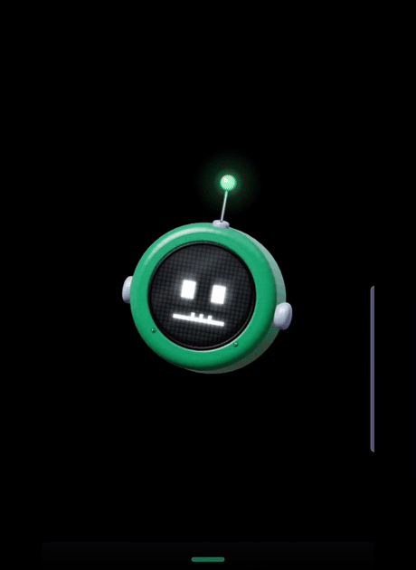
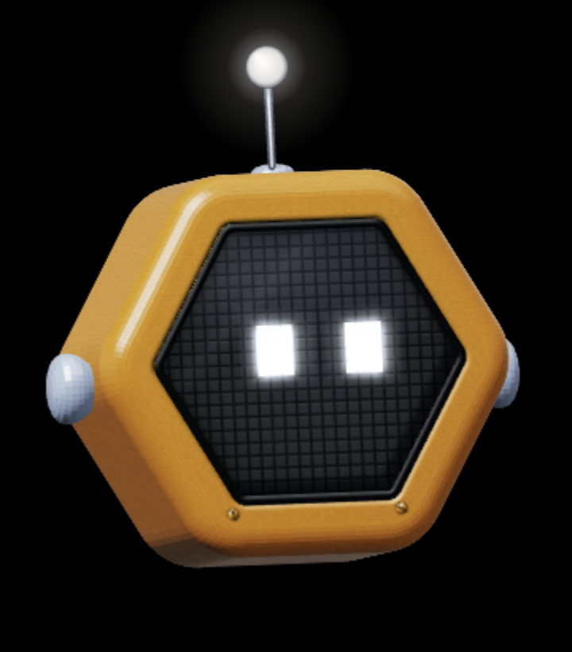

# MyBots

An animated robot head for your Android device, powered by your self-hosted
[Hermes Agent](https://github.com/NousResearch/hermes-agent). The head replaces
the gadget core panel as the face of your agent: it listens, speaks, thinks,
and reacts with you instead of behind a panel. Say "hey jarvis" and talk to it.

This is a fork of Hermes Gadget Android where the robot head (from
[fayazara/robot-heads](https://github.com/fayazara/robot-heads)) replaces the
core panel as the primary visual. The gadget core, JNI bridge, and wire
protocol are unchanged: gadget underneath, head on top.



## Install

Two ways to be running tonight:

- **Human:** [INSTALL.md](INSTALL.md) - APK from Releases, hub config, pairing.
- **Your agent does it:** hand this file to it: [docs/INSTALL-agent.md](docs/INSTALL-agent.md) -
  step-by-step the agent half of the setup, the hub commands, and verify gates.


## What you get

- Head mode on the home page: expressive robot face driven by agent state
- States: sleeping, idle, thinking, listening, speaking, searching, error
- On-device wake word (sherpa-onnx KWS, no cloud) plus push-to-talk
- Swipe between hub pages; the head morphs while switching
- Touch the head to poke it
- Live status text on the strip under the head
- Optional LED strip control over USB serial

## Screenshots

| Head idle | Head thinking |
|---|---|
|  |  |

Longer demo clips (state range, page morphs, sleep) ship with the
[Releases](../../releases) page.


## Requirements

- A running Hermes Agent gateway, with the gadget plugin from this repo
  enabled (`plugin/gadget/`, installed per [INSTALL.md](INSTALL.md)). It is
  the same wire protocol as the stock plugin plus our fixes for long-answer
  completion and work narration - that is what makes the head feel alive,
  so prefer it over any other copy.
- An Android device on the same network as your gateway (Android 8.0 / API 26+).

## Building from source

1. Install Android Studio (or the Android SDK + NDK) and JDK 17.
2. Get the gadget firmware: it is vendored in
   `third_party/hermes-gadget-firmware` (see [NOTICE](NOTICE)), so nothing to
   fetch. Build:
   ```
   ./gradlew assembleDebug
   ```
   The sherpa-onnx runtime and the KWS wake-word model are vendored in the
   repository, no extra downloads needed.

## Connecting to your hub

1. On first start, the app asks for the hub WebSocket URL (gateway endpoint).
2. The gadget plugin on the gateway shows a pairing code. Approve it there.
3. The device stores its `device_key` and reconnects automatically from then on.

## Privacy

The app talks to exactly one endpoint: your own hub URL. Audio goes from the
microphone to your gateway and nothing else leaves the device. No analytics,
no ad SDKs, no third-party services. Local-first is the whole point.

## How it works (short version)

- The Java/Kotlin app embeds the gadget core firmware (C++) via a JNI bridge,
  the same one the ESP32 gadget firmware uses.
- The head is a WebView running a bundled bundle of robot-heads rendering code
  (`js/mybots-head.ts`). The app drives it with a small `window.MB` API:
  state, size, color, poke.
- A 300 ms poller derives the head state from the engine session, audio route,
  and touch: sleeping, error, searching, listening, speaking, thinking, idle.
- Head pages (pager) and touch arbitration are inherited from the gadget app.

## Credits

- [NousResearch/hermes-agent](https://github.com/NousResearch/hermes-agent) for
  the agent and the gadget plugin
- [Adolanium/hermes-gadget-sdk](https://github.com/Adolanium/hermes-gadget-sdk)
  for the gadget core firmware
- [fayazara/robot-heads](https://github.com/fayazara/robot-heads) for the heads
- [k2-fsa/sherpa-onnx](https://github.com/k2-fsa/sherpa-onnx) for on-device
  wake word + ASR

## License

MIT, see [LICENSE](LICENSE). Third-party attributions in
[NOTICE](NOTICE).

MyBots is a community fork, not affiliated with or endorsed by Nous Research.
"Hermes" refers to their product; use "works with Hermes Agent" when describing
compatibility.
